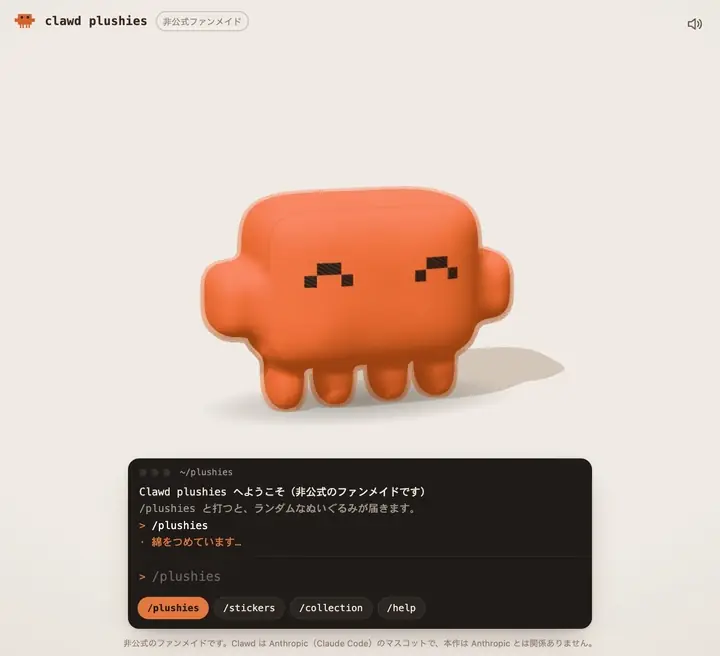
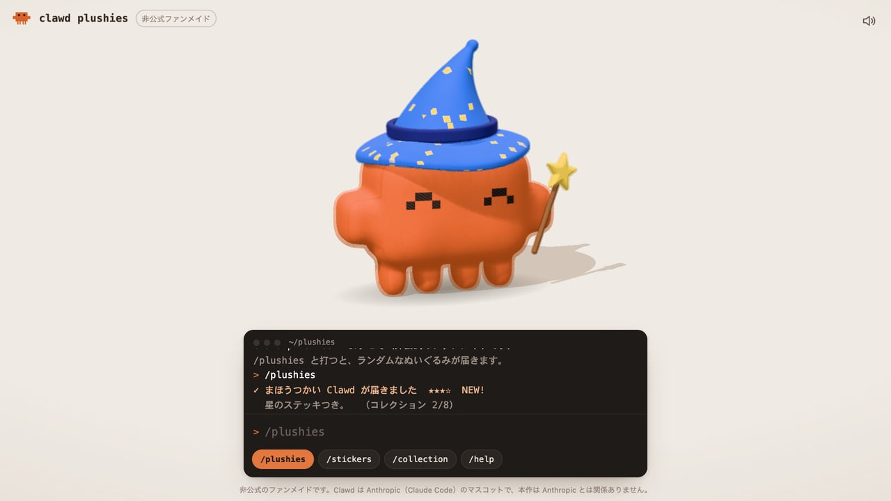
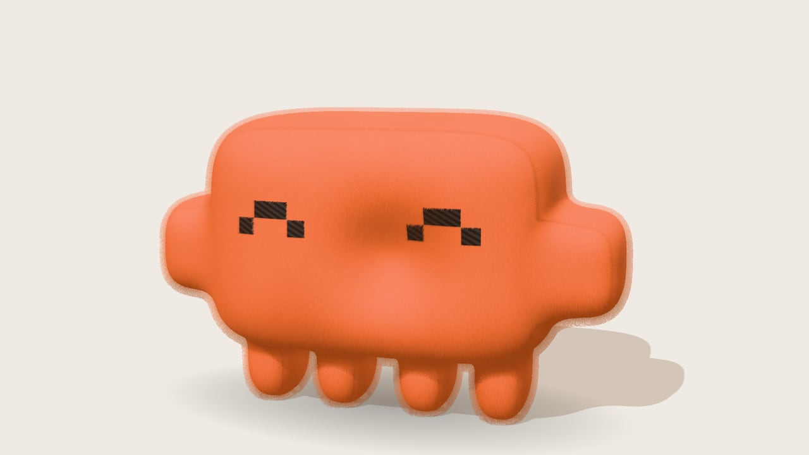
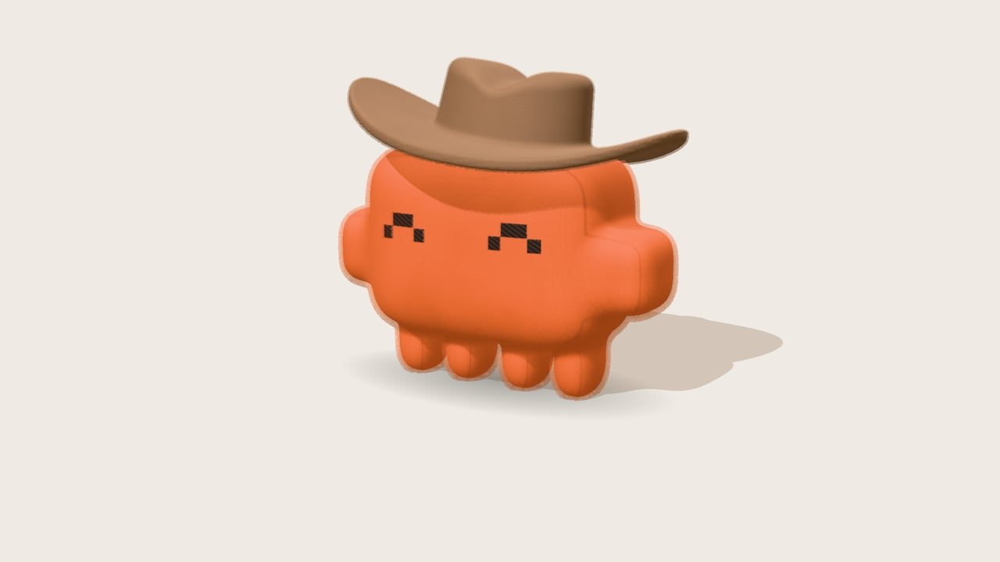
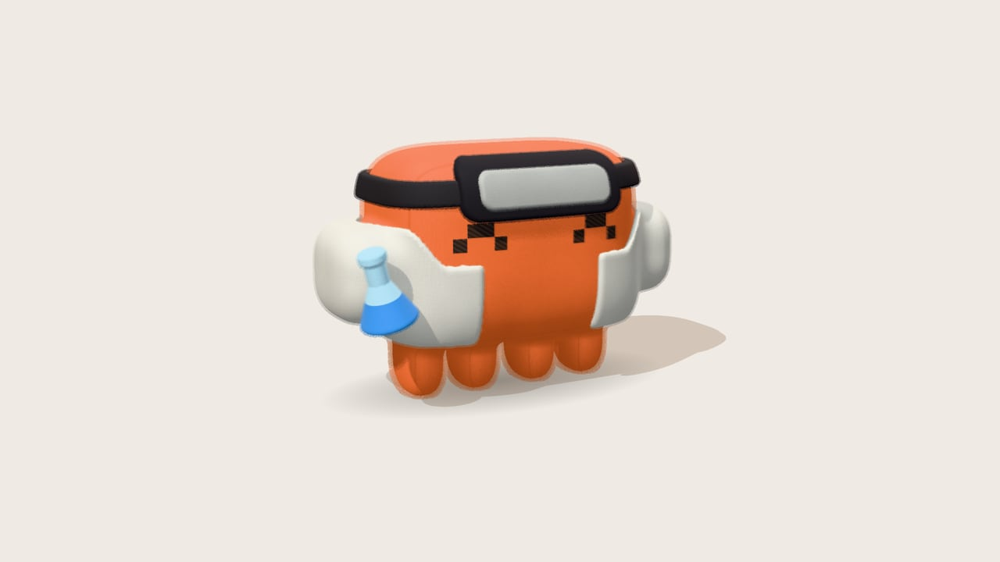
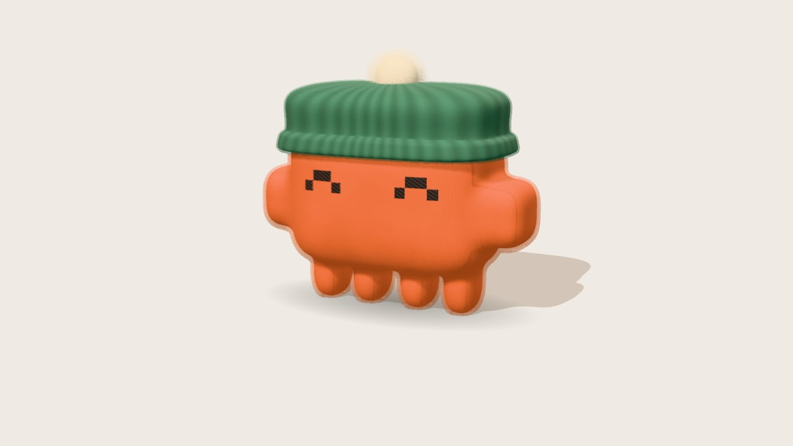
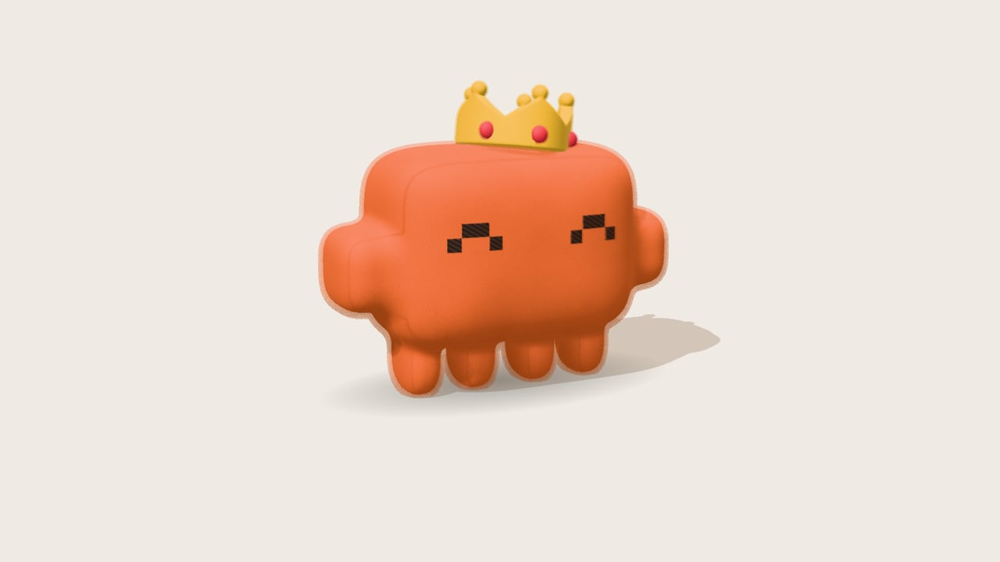
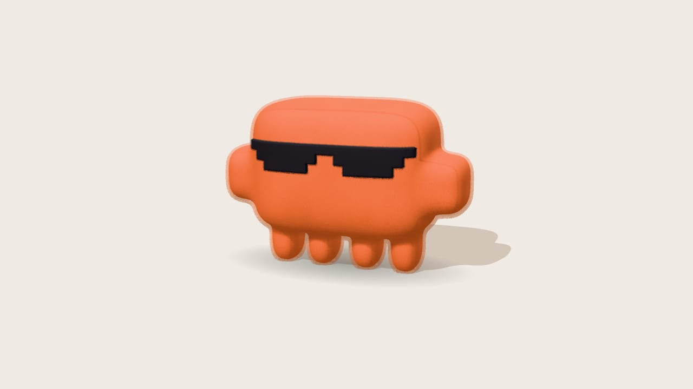
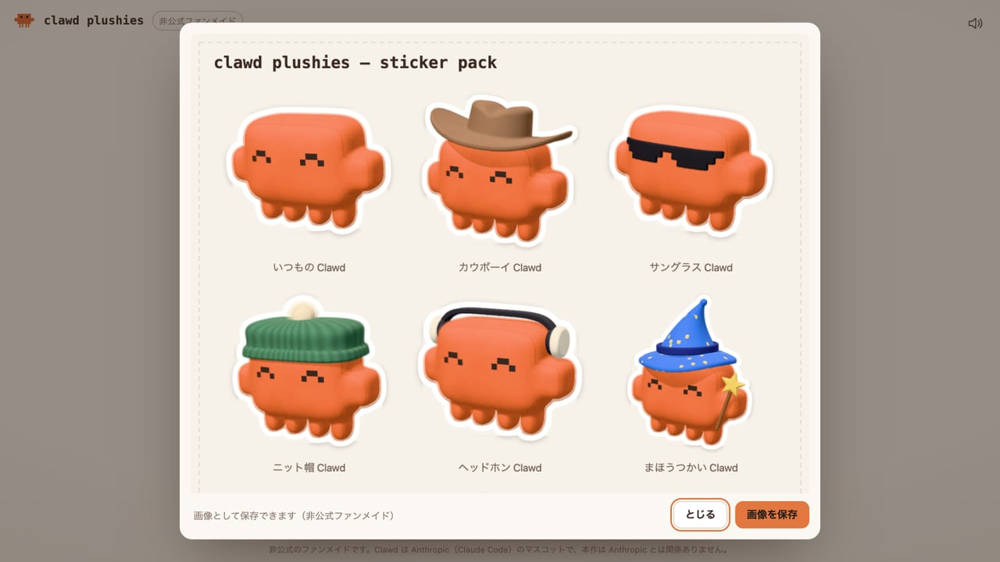

# clawd plushies（クロード プラッシーズ）

Claude Code のマスコット Clawd のぬいぐるみを、ブラウザでさわって集める非公式ファンメイドの 3D トイ。

[](https://tanuu5.github.io/clawd-plushies/)
[](https://www.anthropic.com/claude)
[](./LICENSE)

<p align="center">
  
</p>

<p align="center"><b><a href="https://tanuu5.github.io/clawd-plushies/">▶ ブラウザで今すぐ遊ぶ</a></b>（インストール不要）</p>

**Claude Code × Claude Opus 5.5（XHIGH）** で作りました。

本物のぬいぐるみの手ざわりを目指して、起毛した布の毛並み、ドット絵の刺繍の目、押すとむにっとへこんで戻るやわらかさを再現しました。画面下のターミナルに `/plushies` と打つと、帽子やサングラスを身につけた Clawd がランダムに届きます。形も毛並みも効果音も、画像や音声のファイルを使わず、すべてコードで作っています。

> [!NOTE]
> 非公式のファンメイド作品です。Clawd は Anthropic の Claude Code のマスコットで、この作品は Anthropic とは関係ありません。

## スクリーンショット

<table>
  <tr>
    <td width="50%"><br><sub>/plushies で「まほうつかい Clawd」が届いたところ。ターミナルにレア度とコレクションの数が出ます。</sub></td>
    <td width="50%"><br><sub>顔を押しているところ。押した場所がへこみ、体ごと少しのけぞります。</sub></td>
  </tr>
  <tr>
    <td width="50%"><br><sub>カウボーイ Clawd。帽子はフェルト、本体は短い起毛の布です。</sub></td>
    <td width="50%"><br><sub>かがくしゃ Clawd。ゴーグルと実験着で、フラスコを抱えています。</sub></td>
  </tr>
  <tr>
    <td width="50%"><br><sub>ニット帽 Clawd（この作品のオリジナル）。ぽんぽんは毛足の長い布です。</sub></td>
    <td width="50%"><br><sub>おうさま Clawd（この作品のオリジナル）。いちばん出にくいレアです。</sub></td>
  </tr>
  <tr>
    <td width="50%"><br><sub>サングラス Clawd。ドット絵のサングラスは顔の丸みに沿っています。</sub></td>
    <td width="50%"><br><sub>/stickers で、集めたぬいぐるみを白フチのステッカーシートにして保存できます。</sub></td>
  </tr>
</table>

画像と動画は、すべて実際の画面です。

## 遊び方

| 操作 | 内容 |
| --- | --- |
| ぬいぐるみをクリック | むにっとへこむ。押し続けると深くへこみ、離すとぷるんと戻る |
| 押したまま動かす | なでる（へこみがカーソルについてくる） |
| 背景をドラッグ | 回す・上下から眺める |
| ダブルクリック | ジャンプして宙返り |

画面下のターミナルにコマンドを打つか、下のボタンを押します。

| コマンド | 内容 |
| --- | --- |
| `/plushies` | ランダムなぬいぐるみが届きます（全 8 種、レア度つき） |
| `/stickers` | 集めたぬいぐるみでステッカーシートを作り、PNG で保存できます |
| `/collection` | 集めた一覧。名前をクリックすると呼び出せます |
| `/help` | コマンドとさわりかたの一覧 |

- 集めたぬいぐるみはブラウザ（localStorage）に保存されます。
- 右上のボタンで効果音をオン・オフできます。音は最初にクリックしたあとから鳴ります。

## 制作について

企画・ディレクション：**たぬ**　／　開発：**Claude Code（Claude Opus 5.5・推論レベル XHIGH）**

配布されたぬいぐるみの写真を手がかりに、形・毛並み・刺繍の目・衣装の再現から、押したときの変形、ターミナル風の UI、ステッカーづくりまでを Claude Code が実装しました。形は距離関数（SDF）から Web Worker でメッシュを作り、毛並みは同じ形を少しずつ膨らませた層を重ねるシェル法、へこみや潰れは頂点シェーダで計算しています。見た目はヘッドレス Chrome（実 GPU）で撮影して確かめ、布の色は写真の平均色と描画結果を数値で比べて合わせました。

## 更新履歴

- **2026-10-01**：公開

## 開発

ビルドは不要です。静的なファイルを配信すれば動きます（ES モジュールと Web Worker を使うので、`file://` で直接開くのではなく HTTP で配信してください）。

```bash
python3 -m http.server 8765
# http://localhost:8765 を開く
```

| ファイル | 中身 |
| --- | --- |
| `index.html` | 画面の骨組み、スタイル、three.js の読み込み（import map） |
| `src/main.js` | シーン・ライト・カメラ、操作、コマンド、ステッカーの撮影 |
| `src/plush.js` | ぬいぐるみ 1 体の組み立て（毛並み・変形のシェーダ、ばねの物理） |
| `src/parts.js` | 本体と衣装の形（距離関数）、布の設定、ガチャのラインナップ |
| `src/sdf.js` | 距離関数の部品と Surface Nets によるメッシュ化 |
| `src/mesher.worker.js` | メッシュ化を別スレッドで行う Web Worker |
| `src/stickers.js` | 白フチのステッカーとシートの合成 |
| `src/sound.js` | Web Audio で合成する効果音 |
| `src/terminal.js` | ターミナル風の入出力 |

`?debug` を付けて開くと、撮影や調整用の `window.__dbg` が使えます（`__dbg.deliver('wizard')` で衣装を呼ぶ、など）。

## GitHub Pages で公開する

リポジトリの Settings → Pages で、Source を「Deploy from a branch」、Branch を `main` の `/ (root)` にします。

## クレジット・ライセンス

- コード：MIT License（[LICENSE](LICENSE)）© 2026 たぬ
- **Clawd について**：Clawd は Anthropic の Claude Code のマスコットです。この作品のぬいぐるみの Clawd は、公式アセットを使わずにコードで描き起こした二次創作（ファンアート）です。Clawd のキャラクターは MIT License の対象外で、名称とキャラクターの権利は Anthropic に帰属します。
- 衣装のうち、カウボーイハット・サングラス・まほうつかい・かがくしゃは配布されたぬいぐるみをもとにしたもの、ニット帽・ヘッドホン・王冠はこの作品のオリジナルです。
- 3D 描画：[three.js](https://threejs.org/) r170（MIT License、jsDelivr から読み込み）
- MIT License の対象はこのリポジトリのコードと文章です。「Claude」の名前や商標の使用を許諾するものではありません。
